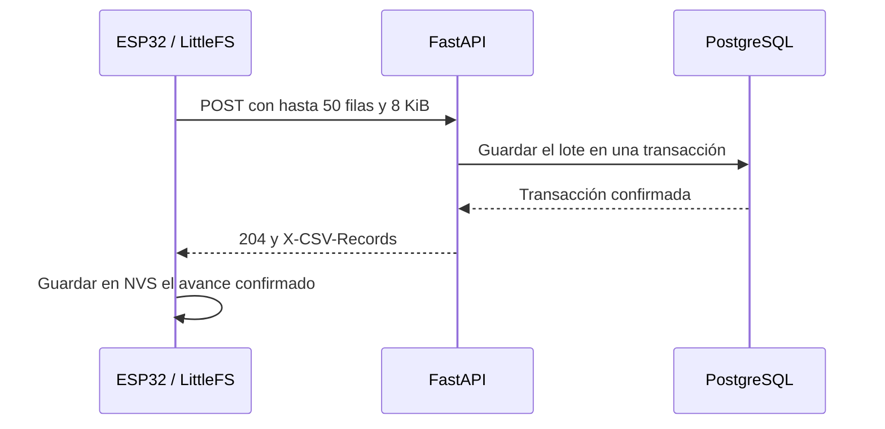

# Monitor de aire ESP32-S3

Cada 2 segundos publica el JSON en `dispositivo/ESP32_S3_0001/tratado`.
Si MQTT esta desconectado o falla publish, agrega las lecturas a un unico archivo
en LittleFS (`/pending.csv`). Con [el reenvío HTTP activado](#reenviar-el-historial-por-http),
manda las filas pendientes en lotes a FastAPI. Por defecto, al reconectar
publica una fila por mensaje en `dispositivo/ESP32_S3_0001/crudo`.
Python escucha `dispositivo/+/crudo`,
convierte al mismo JSON y publica en `dispositivo/<ID>/tratado` con QoS 1.
Tras la confirmacion del broker, Python publica el ID del registro en
`dispositivo/<ID>/ack`. El ESP32 guarda el avance confirmado en NVS para
continuar despues de reiniciar. Las filas confirmadas permanecen fisicamente
en el archivo hasta confirmar todas las filas; entonces se elimina el CSV
completo. Si se pierde el ACK se reintenta la misma fila.
Los reintentos pueden producir duplicados. Las publicaciones actuales usan
QoS 0 (limitacion de PubSubClient): publish exitoso no garantiza recepcion.
Las filas del historial se reenvian en el orden en que se guardaron; las
lecturas actuales siguen publicandose directamente mientras se envia el historial.

`dispositivo/<ID>/estado` conserva `conectado` y usa Last Will para indicar
`desconectado` tras perder la conexion. Serial informa las transiciones.
El comodin `+` se utiliza al suscribirse, nunca al publicar.

## Configuracion y ejecucion

1. En `data/config.json` configura SSID, PASS, MQTT_HOST y MQTT_PORT.
   PASS corresponde exclusivamente a la clave de tu red WiFi.
   MQTT_HOST contiene una IP de ejemplo: reemplazala por la IP LAN de tu PC.
   En ESP32, localhost apuntaria al propio ESP32.
2. Configura tu broker para aceptar conexiones anonimas desde la LAN.
   El firmware y Python se conectan sin usuario ni contrasena MQTT, mediante TCP sin TLS.
   Desde `Monitor_Aire`, puedes iniciarlo con `mosquitto -c backend/scripts/mosquitto.conf`.
3. Desde `Monitor_Aire/ESP32`, ejecuta `pio run -t uploadfs` para cargar
   `config.json` y `pio run -t upload` para cargar el firmware. Subir LittleFS
   de nuevo reemplaza los CSV existentes.
4. Para ejecutar el conversor independiente, desde `Monitor_Aire` en la computadora del broker:

```bash
python3 -m venv backend/.venv
backend/.venv/bin/python -m pip install -r backend/scripts/requirements.txt
backend/.venv/bin/python -m backend.scripts.csv_to_json --host localhost --port 1883
```

Para observar el JSON, suscribete a `dispositivo/+/tratado`.
Cambia DEVICE_ID en main.cpp para cada placa. No ejecutes multiples conversores
simultaneos sobre la misma suscripcion porque duplicarian las publicaciones.

## Dashboard web

El dashboard Svelte muestra las últimas lecturas y el estado de cada ESP32 vía
MQTT. La gráfica usa promedios de los últimos 24 h, 7 días o 30 días. El
historial se puede filtrar por fecha y exportar completo para el dispositivo
seleccionado. La interfaz usa la hora de Ciudad de México.

### Configurar el servicio

Necesitas un servidor PostgreSQL 14 o posterior, Python 3.11 o posterior,
Node.js 20.19 o 22.12 en adelante y el broker Mosquitto del proyecto. En el
servidor PostgreSQL que administras en pgAdmin, crea un rol con acceso de
inicio de sesión (`monitor_aire`) y una base de datos (`monitor_aire`) cuyo
propietario sea ese rol. El backend aplica `backend/schema.sql` al iniciar.
Si la base solo tiene las tablas de la versión anterior (`dashboard_*`), el
backend las renombra y conserva sus datos.

Desde la raíz de `Monitor_Aire`, donde están `backend` y `frontend`:

```bash
python3 -m venv backend/.venv
backend/.venv/bin/python -m pip install -r backend/requirements.txt
test -f backend/.env || cp backend/.env.example backend/.env
backend/.venv/bin/python -c 'import secrets; print(secrets.token_hex(32))'
```

En `backend/.env` completa `DATABASE_URL` con la contraseña del rol y guarda
la clave generada en `JWT_SECRET`. Codifica los caracteres reservados de la
contraseña si usas una URL de conexión. Si el broker está en otra máquina,
pon su dirección y puerto en `MQTT_HOST` y `MQTT_PORT`. Activa
`COOKIE_SECURE=true` cuando sirvas el dashboard con HTTPS.

```bash
backend/.venv/bin/python -m backend.users operador
```

El comando solicita la contraseña por terminal y almacena su hash Argon2.
La sesión usa un JWT con caducidad en una cookie `HttpOnly`.

### Compilar y abrir

Desde `Monitor_Aire/frontend`:

```bash
npm ci
npm run build
```

Desde la raíz de `Monitor_Aire`:

```bash
backend/.venv/bin/python -m uvicorn backend.app:app --host 127.0.0.1 --port 8000
```

Abre <http://127.0.0.1:8000>. Para desarrollar la interfaz, ejecuta
`npm run dev` en `frontend` con el backend en ejecución. Vite reenvía
`/api` a `127.0.0.1:8000` de forma predeterminada. Conserva una instancia
del backend por cliente MQTT.

### Cómo se registran las lecturas

- Con `MQTT_CONVERT_RAW=true`, el backend usa el conversor existente y
  confirma cada fila pendiente después de guardarla en PostgreSQL y recibir
  la confirmación del broker. Puede reconocer reintentos por ID de registro.
  Detén el conversor standalone al usar este modo. Si decides mantenerlo,
  configura `MQTT_CONVERT_RAW=false` para que el backend consuma sus JSON
  tratados. Esos JSON no llevan identificador para eliminar duplicados.
- Las gráficas, el historial y el CSV requieren la hora de medición del
  ESP32. PostgreSQL conserva las filas sin ella para registrar su recepción.
  El historial y el CSV muestran primero las mediciones más recientes y
  desempatan por hora de recepción. El CSV expresa ambas fechas en la hora
  de Ciudad de México, igual que el panel.
- El dashboard registra desde que el backend empieza a recibir mensajes.
  Las publicaciones en vivo conservan el QoS 0 del firmware. Para conservar
  esas mediciones, mantén activos el broker, el backend y PostgreSQL.

### Reenviar el historial por HTTP

El ESP32 manda hasta **50 lecturas y 8 KiB** de `pending.csv` por
`POST /api/ingest/{device_id}/csv`. El límite de bytes incluye la cabecera.
El ESP32 prepara un solo lote en RAM y realiza una petición a la vez. FastAPI
valida todas las filas, guarda el lote en PostgreSQL en una transacción y
responde con `204` y `X-CSV-Records` con el total confirmado. El ESP32
entonces actualiza el avance guardado en NVS. Si la petición falla, conserva
el lote y reintenta a partir de los cinco segundos. PostgreSQL reconoce las
filas repetidas por dispositivo e identificador de registro. Las lecturas en
vivo siguen por MQTT cada dos segundos.



1. Genera una clave con `python3 -c 'import secrets; print(secrets.token_urlsafe(24))'`.
   Guárdala como `CSV_UPLOAD_TOKEN` en `backend/.env`.
2. Inicia el backend en una interfaz a la que pueda llegar el ESP32 desde
   la red local. Desde `Monitor_Aire`, puedes usar:

   ```bash
   backend/.venv/bin/python -m uvicorn backend.app:app --host 0.0.0.0 --port 8000
   ```

3. Desde `Monitor_Aire/ESP32`, crea `include/csv_upload_local.h` con estas
   dos constantes. Usa la IP LAN de la computadora y el mismo token del
   backend. Git ignora este archivo local.

   ```cpp
   #pragma once

   #define CSV_UPLOAD_BUILD_URL "http://192.168.1.50:8000"
   #define CSV_UPLOAD_BUILD_TOKEN "TOKEN_DEL_BACKEND"
   ```

4. Ejecuta `pio run -t upload` desde `Monitor_Aire/ESP32`. Para preservar
   las lecturas pendientes, sube únicamente el firmware. Subir LittleFS
   con `uploadfs` reemplaza su contenido, incluido `pending.csv`.

Si estás preparando por primera vez el sistema de archivos de una placa,
también puedes configurar `CSV_UPLOAD_URL` y `CSV_UPLOAD_TOKEN` en
`data/config.json`. Cuando el JSON tiene ambas claves completas, sus valores
tienen prioridad sobre los del encabezado local.

## Pines

| Parte | Senal | GPIO ESP32-S3 |
|---|---|---|
| ST7789 | MOSI / SDA | 13 |
| ST7789 | SCLK / SCL | 12 |
| ST7789 | CS | 10 |
| ST7789 | DC | 9 |
| ST7789 | RST | 8 |
| ST7789 | MISO | Sin conectar (-1) |
| DHT11 | DATA | 4 |
| MQ135 | AO mediante divisor | 5 (ADC1) |

Los pines y opciones TFT originales estan copiados a `include/TFT_Setup.h`
y se cargan desde platformio.ini para conservarlos al reinstalar TFT_eSPI.
No se asigna GPIO de retroiluminacion; conserva tu conexion BL actual.
Pantalla: VCC segun tu modulo, GND comun. DHT11: VCC 3.3 V, GND comun,
y pull-up de DATA a 3.3 V si el modulo no lo incorpora.
MQ135: VCC 5 V y GND comun. AO -> resistencia 10 kOhm -> GPIO5;
GPIO5 -> resistencia 10 kOhm -> GND. No conectar AO de 5 V directo al GPIO.
La entrada digital DO del MQ135 queda sin conectar.

## Pantalla del ESP32

La ST7789 muestra la hora local en formato `HH:MM:SS` (UTC−06:00) con un
icono de reloj. Mientras el ESP32 sincroniza con NTP, muestra `ESPERANDO NTP`.
Las tarjetas usan un termómetro para la temperatura, una gota para la humedad
y un icono de flujo para el gas. La pantalla también indica el estado de MQTT
y la preparación del MQ135.

## Mediciones y limites

JSON: device_id, timestamp y measurements.temperature/humidity/gas;
cada medicion incluye sensor, value y unit. Gas incluye calibrate=false.
Los valores invalidos son null en JSON y campos vacios en CSV.
Se usa hora NTP con desplazamiento fijo UTC-06:00; antes de sincronizar,
timestamp es null. No se inventa una fecha para lecturas sin hora conocida.

La curva MQ135 conserva los parametros del codigo de referencia: RL 2 kOhm,
divisor 10k/10k, compensacion ambiental, 30 muestras de referencia y supuesto
de 450 ppm. Requiere sensor estabilizado antes de tomar referencia; se repite
al reiniciar. Son ppm estimadas, no una medicion selectiva de CO2 ni una
calibracion certificada, por lo que calibrate permanece false.

LittleFS no se formatea automaticamente. Si falta, inicializalo con uploadfs.
Cuando queda poco espacio se informa por Serial que no se guardo la lectura.
Una escritura interrumpida puede dejar una fila incompleta: el conversor la
rechaza sin confirmar y el archivo se conserva para revision. Los archivos
/queue de la version anterior no se eliminan ni se migran automaticamente.
Las funciones tienen prototipos antes de setup e implementaciones bajo loop.

El firmware principal usa HSPI a 20 MHz, con los pines de include/TFT_Setup.h.
Para cargar el monitor completo:

```bash
pio run -e esp32-s3-devkitc-1 -t upload
```

## Organizacion del conversor Python

El conversor y la configuración de Mosquitto están en `ESP32/backend/scripts`.
Desde la raíz `ESP32`, también puedes ejecutar el conversor como archivo:

```bash
backend/.venv/bin/python backend/scripts/csv_to_json.py --host 127.0.0.1 --port 1883
```

| Archivo | Responsabilidad |
|---|---|
| `backend/scripts/csv_to_json.py` | Punto de entrada del conversor independiente. |
| `backend/scripts/mqtt_bridge/settings.py` | Constantes MQTT, columnas CSV y nombres/unidades de mediciones. |
| `backend/scripts/mqtt_bridge/models.py` | Modelo `ConvertedReading` compartido entre conversion y transporte. |
| `backend/scripts/mqtt_bridge/converter.py` | Valida topic/CSV y construye JSON sin abrir conexiones. |
| `backend/scripts/mqtt_bridge/bridge.py` | Callbacks, cola, hilo trabajador, publicacion JSON y ACK. |
| `backend/scripts/mqtt_bridge/cli.py` | Argumentos de terminal, creacion del cliente y ciclo MQTT. |
| `backend/scripts/mqtt_bridge/__init__.py` | Identifica el paquete Python. |

Para aplicar los cambios a un conversor que ya esta ejecutandose, detenlo con Ctrl+C y vuelve
 a iniciarlo. No ejecutes dos instancias al mismo tiempo para el mismo historial.
